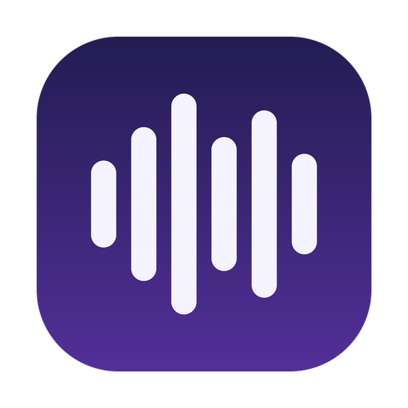
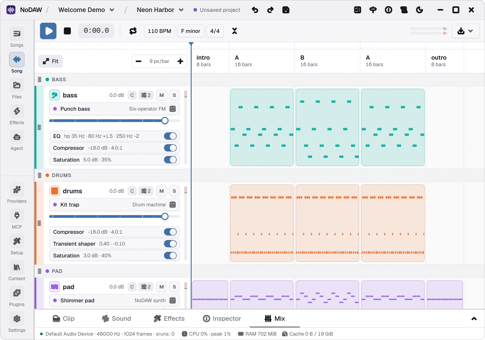
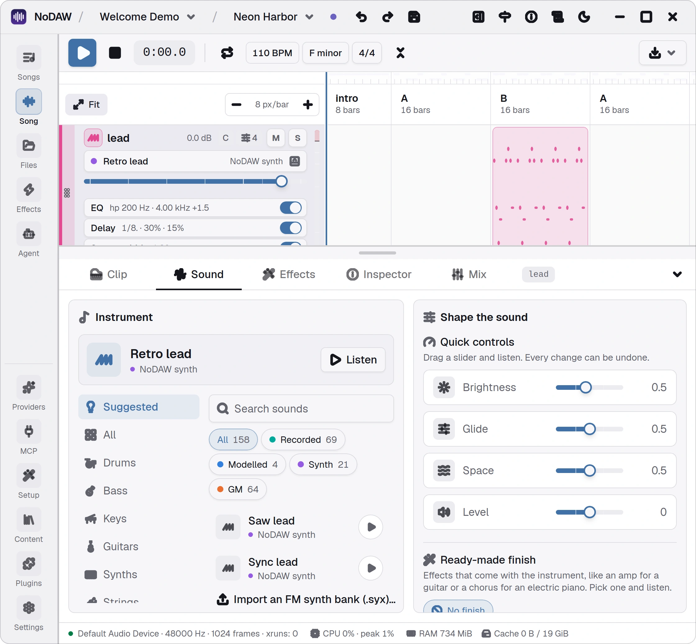

<p align="center">
  
</p>

<h1 align="center">NoDAW</h1>

<p align="center">
  Make music and sound effects by describing them.<br>
  Free for Windows, macOS and Linux.
</p>

<p align="center">
  <a href="https://github.com/bigclumsypanda/nodaw-app/releases/latest"><strong>Download</strong></a>
  ·
  <a href="https://github.com/bigclumsypanda/nodaw-app/issues">Report a problem</a>
  ·
  <a href="#support">Support</a>
</p>

<p align="center">
  <picture>
    <source media="(prefers-color-scheme: dark)" srcset="screenshots/board-dark.webp">
    
  </picture>
</p>

## What you can do

- **Ask for a song.** Say "a calm lo-fi loop in F minor" and get sections, tracks and sounds you can change.
- **Change anything by hand.** Notes, drums, sounds, effects and the mix are all editable, and every step can be undone.
- **Make sound effects.** Describe a sound and keep its variations in your own library.
- **Get a studio sound.** Recorded instruments, mixing and mastering are built in.
- **Choose your AI.** Use an online AI service or a model running on your own computer.
- **Keep your work.** Projects are files on your computer.

## Download

| System                              | File                                  |
| ----------------------------------- | ------------------------------------- |
| Windows 10 / 11                     | `NoDAW_<version>_Beta_x64-setup.exe`  |
| macOS 14 or newer (Apple Silicon)   | `NoDAW_<version>_Beta_aarch64.dmg`    |
| Linux, any distribution             | `NoDAW_<version>_Beta_amd64.AppImage` |
| Ubuntu 22.04 or newer, Debian 12    | `NoDAW_<version>_Beta_amd64.deb`      |
| Fedora                              | `NoDAW_<version>_Beta_x86_64.rpm`     |

When you first start NoDAW, **Studio setup** offers instruments, sounds and optional AI models to download. Pick what you like. You can come back to it any time.

## First launch

NoDAW is free, and its installers are not signed with paid certificates. Your system will ask once whether to trust it.

- **Windows:** if SmartScreen says "Windows protected your PC", click **More info → Run anyway**.
- **macOS:** drag NoDAW into **Applications** and open it. If macOS cannot verify the developer, open **System Settings → Privacy & Security** and click **Open Anyway**. If it says the app "is damaged", run this once in Terminal:
  ```bash
  xattr -dr com.apple.quarantine /Applications/NoDAW.app
  ```
- **Linux:** run `sudo apt install ./NoDAW_*_amd64.deb` or `sudo dnf install ./NoDAW_*_x86_64.rpm`, or make the AppImage executable and start it.

NoDAW updates itself and asks you before it restarts.

## Getting started

1. Create a project on the start screen.
2. Connect an AI under **AI providers**.
3. Tell the assistant what you want to hear, press play, and shape the result.

<p align="center">
  <picture>
    <source media="(prefers-color-scheme: dark)" srcset="screenshots/sound-dark.webp">
    
  </picture>
</p>

## Support

NoDAW is free and made by one developer. If you enjoy it, you can support it on
[Tipeee](https://en.tipeee.com/andriiplaksin/),
[Ko-fi](https://ko-fi.com/skystm) or
[Patreon](https://www.patreon.com/cw/SkySTM).

## License

NoDAW is free for personal and commercial work under the [NoDAW Freeware License](LICENSE.txt). The music and sounds you make with it are yours. The open-source components it uses are listed in `THIRD_PARTY_NOTICES.txt`, which comes with every release and is also under **About** in the app.

Copyright © 2026 Andrii Plaksin.
